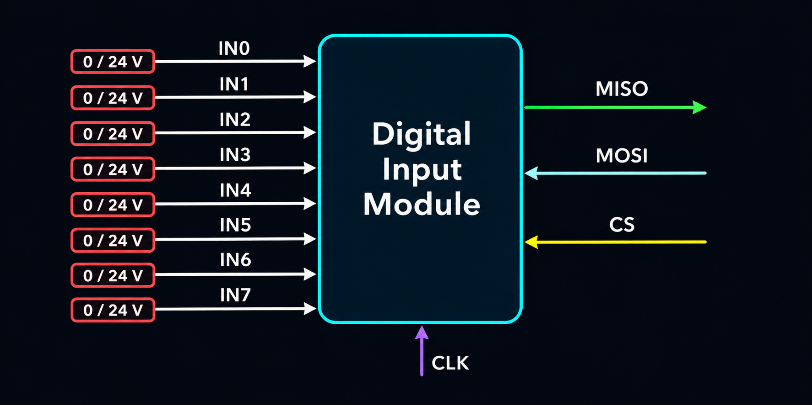
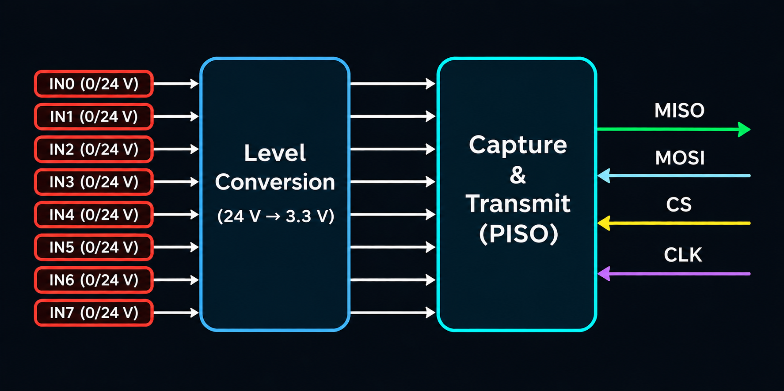
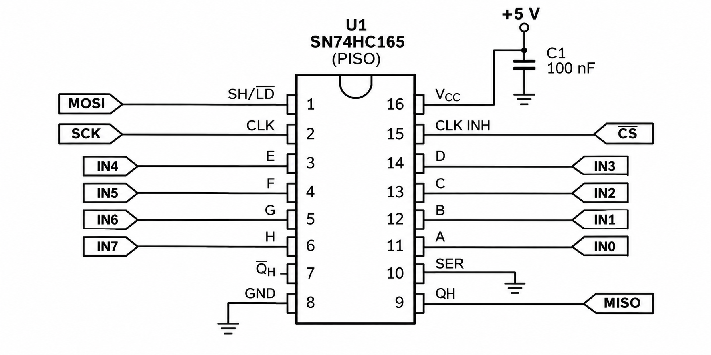

# Digital Input Module

The digital input module reads signals from sensors, buttons, and other field devices and sends them to the CPU.

## Signal flow

Eight 0–24 V inputs are converted to eight 0–5 V logic signals, then represented as an 8-bit numeric value.

## Main blocks

The module has two main parts: voltage conversion, and signal capture and transmission.

## Capture and transmit block

The capture and transmit block uses an **SNx4HC165 8-bit parallel-load shift register**.

It receives data on eight parallel inputs, then shifts it to the serial `QH` output when clocked. The parallel inputs `A`–`H` are loaded when `SH/LD` is low. The device also provides a clock-inhibit input (`CLK INH`) and a complementary serial output (`QH̅`).

### Connections

- Parallel input pins: `A`–`H`
- Serial outputs: `QH` and complementary `QH̅`
- `CLK` is connected directly to the SPI clock.
- `CLK INH` is connected to chip select (`CS`). When it is high, shifting is stopped.
- `SER` is connected to GND so zeroes are shifted in after all data has been transmitted.
- Output data is sent through `MISO`.
- `SH/LD` is controlled through `MOSI`.
- `VCC` supplies the shift register with the 5 V logic supply.

### Decoupling capacitor

A ceramic decoupling capacitor should be connected between `VCC` and `GND`, as close as possible to the shift-register pins. It supplies brief current peaks during switching and filters high-frequency noise, helping the module operate reliably. A typical value is **100 nF**.

### Pin functions

| Pin | I/O | Description |
| --- | --- | --- |
| A, B, C, D, E, F, G, H | Input | Parallel inputs |
| CLK | Input | Clock input |
| CLK INH | Input | Clock inhibit; when high, the output does not change |
| GND | — | Ground |
| QH | Output | Serial output |
| QH̅ | Output | Complementary serial output |
| SER | Input | Serial input |
| SH/LD | Input | Shift/load control; high shifts data, low loads parallel inputs |
| VCC | — | 5 V power supply |

## Reference

- [TI SNx4HC165 8-Bit Parallel-Load Shift Registers datasheet](https://www.ti.com/lit/ds/symlink/sn74hc165.pdf)
