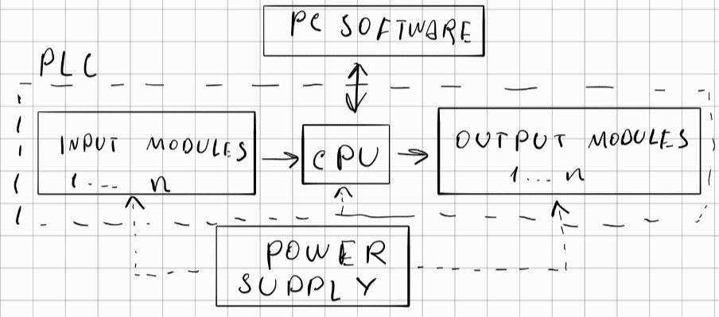
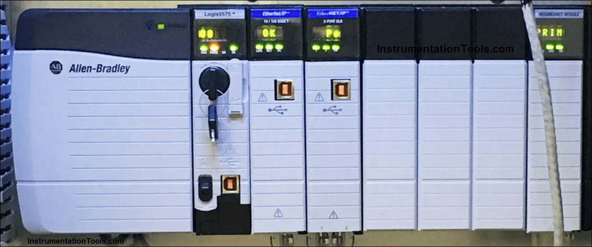

# PLC Main Concept

## 1. Purpose

The project consists of the development of a **Programmable Logic Controller (PLC)** with a modular architecture.

The main purpose of the PLC is to simplify the control and integration of different types of:

* Sensors
* Actuators
* Communication devices
* Industrial equipment

The system will allow different input and output modules to be selected depending on the application.

---

## 2. System Architecture

The PLC will consist of the following main components:

* **Input Modules**
* **CPU**
* **Output Modules**
* **Power Supply**
* **PC Software**

  

### 2.1 Input Modules

The input modules will:

* Receive signals from external sensors and devices.
* Perform the required electrical and signal conversions.
* Provide processed input data to the CPU.

The number and type of input modules may vary depending on the application.

### 2.2 CPU

The CPU will be the central processing unit of the PLC.

It will:

* Read data from the input modules.
* Execute the PLC control program.
* Process system logic.
* Determine the required output states.
* Send commands to the output modules.
* Communicate with the PC software.

### 2.3 Output Modules

The output modules will:

* Receive commands from the CPU.
* Perform the required electrical and signal conversions.
* Control external actuators and devices.

The number and type of output modules may vary depending on the application.

### 2.4 Power Supply

The power supply will provide the required electrical power for:

* CPU
* Input modules
* Output modules

The power architecture may be adapted according to the voltage and power requirements of the installed modules.

### 2.5 PC Software

The PC software will provide an interface between the user and the PLC.

It will be used to:

* Program and configure the PLC.
* Monitor the PLC state.
* View system information.
* Display logs and diagnostic information.

---

## 3. Module Types

The PLC will support different types of modules.

### Input / Output Modules

* **Digital I/O**
* **Analog I/O**

### Communication Modules

* **Ethernet**
* **CAN**
* **UART**

Additional communication protocols and interface modules may be added in the future.

The modular architecture will allow the number and type of modules to be selected according to the requirements of the application.

---

## 4. Electrical Interfaces

The PLC input and output interfaces will not be limited to standard microcontroller logic levels such as:

* **3.3 V**
* **5 V**

Different modules may support different electrical standards depending on their purpose.

Examples include:

* **12 V**
* **24 V**
* Analog voltage signals
* Digital industrial signals
* Application-specific interfaces

Each module will perform the required electrical conversion between the external device and the PLC internal electronics.

---

## 5. Environmental and Electrical Protection

The PLC will be designed for operation in industrial environments.

The design should provide protection against:

* **Heat**
* **Electromagnetic interference (EMI)**
* Electrical noise
* Voltage transients

Additional protection mechanisms may be added during the detailed hardware design stage.

---

## 6. Reference Model

The modular hardware architecture is inspired by commercial industrial PLC systems such as the **Allen-Bradley ControlLogix** platform.

  

  <em>Example of an Allen-Bradley ControlLogix modular PLC system.</em>

